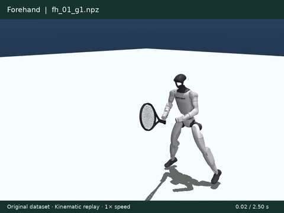
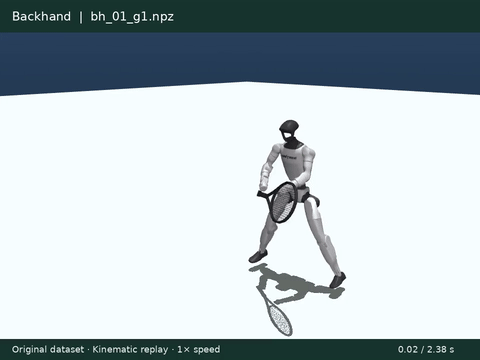
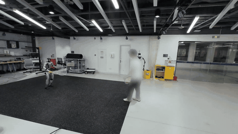
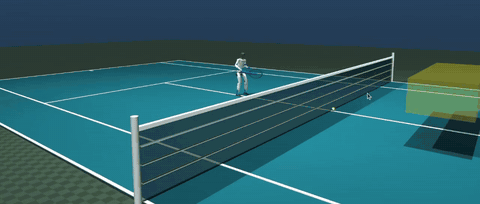

# ATHLETE：基于轨迹引导运动匹配的人形机器人反应式网球学习

[English](README.md) | **简体中文**

[项目网页与交互演示](https://hazintihoa.github.io/ATHLETE/) · [论文](https://arxiv.org/abs/2610.13572)

Unitree G1 反应式全身网球策略的训练与部署代码。

## 数据下载

### 原始动作数据

- **G1 重定向网球击球动作：**[164 个 NPZ 及 JSON 标注](data/djvkovic_npz_data_v5/)，正手 97 条、反手 67 条。先用 [GVHMR](https://github.com/zju3dv/GVHMR) 从网球视频重建人体动作，再用 [GMR](https://github.com/YanjieZe/GMR) 重定向到 G1。已包含在仓库的 `data/djvkovic_npz_data_v5/` 中。

原始数据回放：正手、反手各 3 条，以 1× 速度播放。这是 164 条源动作数据的运动学回放，不是 mimic policy rollout。

| 正手（`fh_01`、`fh_32`、`fh_64`） | 反手（`bh_01`、`bh_22`、`bh_45`） |
| --- | --- |
| [](media/strike-replays/forehand.mp4) | [](media/strike-replays/backhand.mp4) |

[Forehand MP4](media/strike-replays/forehand.mp4) · [Backhand MP4](media/strike-replays/backhand.mp4)

- **G1 重定向 LAFAN1 走跑动作：**[Hugging Face 下载](https://huggingface.co/datasets/lvhaidong/LAFAN1_Retargeting_Dataset/tree/main/g1)。使用其中 16 个 `run*.csv`／`walk*.csv` 文件，经 `scripts/prepare_lafan_locomotion.py` 转换到 `data/lafan_npz_data/runandwalk/`。该上游数据由原维护者单独提供。

### 生成动作数据

- **Student 参考动作：**[Google Drive 下载](https://drive.google.com/drive/folders/1CWTzU1l1Bo3vszM7OkWS0bBAl8Cbif2K?usp=sharing)。TGMM 生成的“移动 + 击球”动作经过 mimic policy rollout 后记录，并重新标注球目标。将 NPZ／JSON 文件直接放入 `artifacts/rollout_1000epis_relabelled/`。

## 演示视频

来自项目网页的首页实机视频与鼠标拖球仿真交互视频。点击预览可播放完整 MP4。

| 实机回合 | 仿真交互 |
| --- | --- |
| [](https://hazintihoa.github.io/ATHLETE/assets/video/hero-7strikes-1080.mp4) | [](https://hazintihoa.github.io/ATHLETE/assets/video/sim-rally1.mp4) |

## 1. 环境配置

Quick Demo 与训练共用 Python 环境：Python 3.13.14，以及 `uv.lock` 锁定的依赖。**不需要 ROS 2、Unitree SDK 或独立的实机部署环境。**已在 Ubuntu 24.04、NVIDIA GPU 的本地机器验证；有窗口模式需要桌面显示。ONNX 策略使用 CPU 推理，来球规划使用训练环境中的 Torch／Warp。

```bash
git clone https://github.com/HazinTihoa/athlete-humanoid-tennis.git
cd athlete-humanoid-tennis
uv python install 3.13.14
uv venv --python 3.13.14 .venv
uv sync --frozen
```

后续命令均在仓库根目录执行。`uv run` 自动使用 `.venv`，无需手动激活。实机部署环境另外配置，见下方部署 TODO。

### 快速 Demo：无 ROS 的 MuJoCo 仿真

ONNX 模型和机器人资源已包含在仓库中。**不需要下载参考动作数据、LAFAN1 数据或 Teacher checkpoint。**机器人从固定站姿启动，通过独立的物理来球采样自动发球，不做动作匹配。

```bash
uv run python scripts/demo_mujoco.py
```

默认使用仓库包含的 **GPU3-2 Full-flight + 回位速度奖励**模型 `deploy/policies/gpu3_2_model45000/model_45000.onnx`，观测维度 631、关节动作维度 29、控制频率 50 Hz。启动后直接开启策略控制并自动发球。目标落点位于启动坐标系前方 5 米；策略接收当前机器人坐标系下的目标以及相对骨盆的球拍速度，与该模型训练配置一致。关闭 MuJoCo 窗口即可退出。

无窗口运行 20 秒仿真，实际执行策略控制：

```bash
uv run python scripts/demo_mujoco.py --headless --duration-s 20 --no-realtime
```

手动发球可运行 `uv run python scripts/demo_mujoco.py --manual`，在单独的球场图中点击机器人一侧的一次落点。这是点击落点模式，与项目网页视频中的鼠标拖球界面不同。使用 `--onnx-policy-file PATH` 可明确指定另一份兼容的 Student 模型。

## 2. 训练流程

- [ ] TODO：补充训练说明。

## 3. 部署流程

- [ ] TODO：补充部署说明。

## 发布状态

### 已发布

- [x] **训练代码：**Teacher、Student 蒸馏与 PPO 微调（`athlete/`）。
- [x] **部署代码：**MuJoCo 仿真与 G1 实机部署（`deploy/`）。
- [x] **TGMM：**数据库构建与运动学参考生成（`motion_matching/`）。
- [x] **G1 重定向网球数据集：**164 个 NPZ 及 JSON 标注，正手 97 条、反手 67 条（`data/djvkovic_npz_data_v5/`）。
- [x] **生成的 Student 参考数据：**经过 mimic policy rollout，并重新标注球目标 — [Google Drive 下载](https://drive.google.com/drive/folders/1CWTzU1l1Bo3vszM7OkWS0bBAl8Cbif2K?usp=sharing)。
- [x] **Student checkpoint 与 ONNX：**`model_36499.pt` 和 `model_36499.onnx`（`deploy/policies/m14_11/`）。
- [x] **Quick Demo ONNX：**GPU3-2 Full-flight 的 `model_45000.onnx`、训练配置与校验值（`deploy/policies/gpu3_2_model45000/`）。未包含其源 `.pt` checkpoint。

### TODO

- [ ] **生成的 Teacher 参考数据集：**`rollout_1000epis`，1000 条动作，保留原始规划球目标。
- [ ] **详细复现说明：**环境配置、数据准备、TGMM、训练、评估与部署。

## 致谢

感谢以下项目的作者：

- [GVHMR](https://github.com/zju3dv/GVHMR)：从源网球视频重建人体动作
- [GMR](https://github.com/YanjieZe/GMR)：将重建的人体动作重定向到 Unitree G1

- [TaskNPoint](https://github.com/wernerb43/tasknpoint)：本项目目标条件动作跟踪部分的基础
- [mjlab](https://github.com/mujocolab/mjlab)：GPU 加速的 MuJoCo 仿真与强化学习环境框架
- [Instinct-RL](https://github.com/project-instinct/instinct_rl)：Teacher–Student 蒸馏所改编的 TPPO 算法
- [Motion-Matching](https://github.com/orangeduck/Motion-Matching)（Daniel Holden）：`motion_matching/` 中移植的运动匹配核心
- [RSL-RL](https://github.com/leggedrobotics/rsl_rl)：强化学习训练框架
- [Unitree](https://github.com/unitreerobotics/unitree_ros)：G1 机器人模型与网格
- [LAFAN1](https://github.com/ubisoft/ubisoft-laforge-animation-dataset)：走跑参考动作的数据来源

## 许可证

见 [`LICENSE.md`](LICENSE.md)。第三方组件保留各自的许可证；其中改编自 Instinct-RL 的 TPPO 实现采用
CC BY-NC 4.0 许可证，不可用于商业用途。
